<div align="center">

# 🚗 Depreciation Decoder

### How used cars lose value in the Indian market


An age-adjusted analysis of **6,900+ used-car listings** from CarDekho, with two original decision-support tools: a **Value Retention Score** and a **Deal Score**.

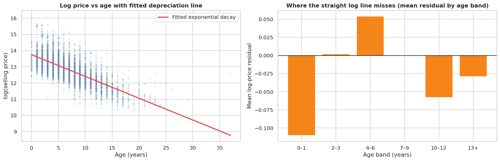

</div>

---

## At a glance

| 📉 Depreciation | ⛽ Diesel premium | 🎯 Deal Score accuracy | 📊 Price explained |
|:---:|:---:|:---:|:---:|
| **12.6%** of value lost per year | **27%** like-for-like (72% raw) | **±11%** median pricing error | **88%** of price variation |

**Notebook:** [`cardekho_depreciation_decoder.ipynb`](cardekho_depreciation_decoder.ipynb) &nbsp;|&nbsp; **Data:** [Kaggle: Vehicle dataset from CarDekho](https://www.kaggle.com/datasets/nehalbirla/vehicle-dataset-from-cardekho)

## Contents

[The problem](#the-problem) · [Key findings](#key-findings) · [Value Retention Score](#original-feature-1-value-retention-score) · [Deal Score](#original-feature-2-deal-score) · [What moves price](#what-moves-price) · [All 11 questions](#all-11-questions-at-a-glance) · [Data cleaning](#data-cleaning) · [Limitations](#limitations) · [How to run](#how-to-run) · [Dataset](#dataset)

---

## The problem

Depreciation is the biggest hidden cost of owning a car, yet most buyers and sellers judge a price by gut feel. This project answers two practical questions:

1. **How fast do cars lose value**, and which brands and features move the price?
2. **Is a given listing a good deal or overpriced**, given its age, mileage, specs and model?

> Prices are *asking* prices in INR, and every result is an association, not a proven cause.

## Key findings

| # | Finding |
|:-:|---|
| 1 | **Cars lose about 12.6% of their value per year** (95% CI 12.3–12.9%). Log price against age explains 52% of the variation in price, against 19% for a straight line, so depreciation is a percentage per year, not a fixed amount. |
| 2 | **14.8% of the rows (1,202) are exact duplicates**, up to 34 copies of one listing, concentrated in dealer listings and luxury brands. They are removed first. |
| 3 | **The Value Retention Score measures depreciation, not price level.** Mainstream brands keep roughly 86–92% of their value per extra year; a naive "age-adjusted price" would rank BMW, Mercedes and Audi first just because they are expensive. |
| 4 | **The diesel premium shrinks but does not vanish**: 72% on raw averages, about 27% (95% CI 25–29%) after controlling for age, mileage, power, engine, transmission, owners, seller and brand. |
| 5 | **Mileage flips sign with the controls.** Doubling kilometres goes with a 16% lower price raw, 7.9% *higher* once age is held fixed (high-mileage cars are mostly diesels), and about 4% lower once car type is controlled. |
| 6 | **The Deal Score is a shortlist tool, not a verdict.** The fair-price model has a cross-validated R² of 0.92 and a median error of about 11%, so scores within roughly ±11% are noise. |

---

## Original feature 1: Value Retention Score

> **What it is:** the percentage of its value a brand's car keeps for each extra year of age, holding power and kilometres constant.

A brand's average price mostly reflects what kind of cars it sells, not how fast they lose value. So the score comes from each brand's **own** depreciation rate: one regression per brand (100+ listings) of log price on age, power and kilometres.

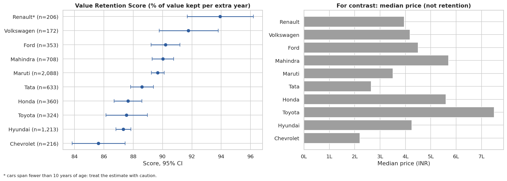

| Brand | Listings | Score (% kept per year) | 95% CI |
|---|---:|---:|---:|
| Volkswagen | 172 | **91.8** | 89.8–93.8 |
| Ford | 353 | **90.2** | 89.2–91.2 |
| Mahindra | 708 | **90.0** | 89.3–90.8 |
| Maruti | 2,088 | **89.7** | 89.2–90.1 |
| Tata | 633 | 88.6 | 87.8–89.4 |
| Honda | 360 | 87.6 | 86.7–88.6 |
| Toyota | 324 | 87.5 | 86.1–89.0 |
| Hyundai | 1,213 | 87.3 | 86.8–87.8 |
| Chevrolet | 216 | 85.6 | 83.8–87.4 |

Renault (93.9) is left out of the table because its cars span only 0–8 years, which makes the estimate unreliable. Luxury brands have too few listings after de-duplication to score. The differences are modest and several intervals overlap, so only the ends of the ranking are firm. **Toyota is the priciest brand scored but depreciates faster than Maruti**: price level and retention are different things.

---

## Original feature 2: Deal Score

> **What it is:** how far a listing's asking price sits **below** the fair price predicted for that car (negative means overpriced).

Three fair-price models were compared with 5-fold cross-validation, and every listing is scored by a model that **never saw that listing**:

| Fair-price model | CV R² (log price) | Median error |
|---|---:|---:|
| Linear regression (specs + brand) | 0.883 | 15.6% |
| Ridge regression (+ model name) | 0.917 | 12.1% |
| **Gradient boosting (+ model name)** | **0.924** | **10.9%** |

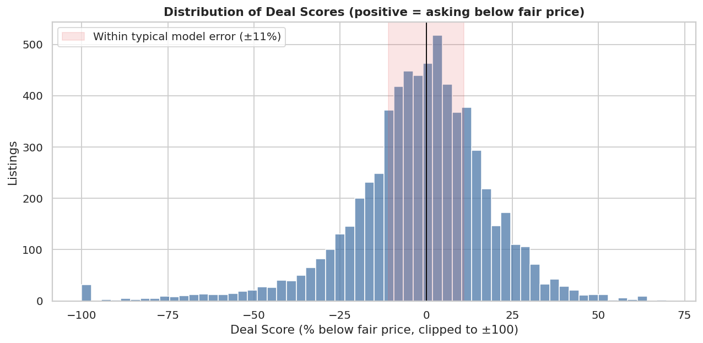

The lists of bargains and overpriced listings use only models with 20+ comparable listings. Extreme scores usually reflect what the data cannot see (variant, condition, accident history), so treat the score as a **shortlist to inspect in person**, not a guarantee.

---

## What moves price

Holding everything else constant (multiple regression on log price, robust standard errors, R² 0.88):

<table>
<tr>
<td width="55%">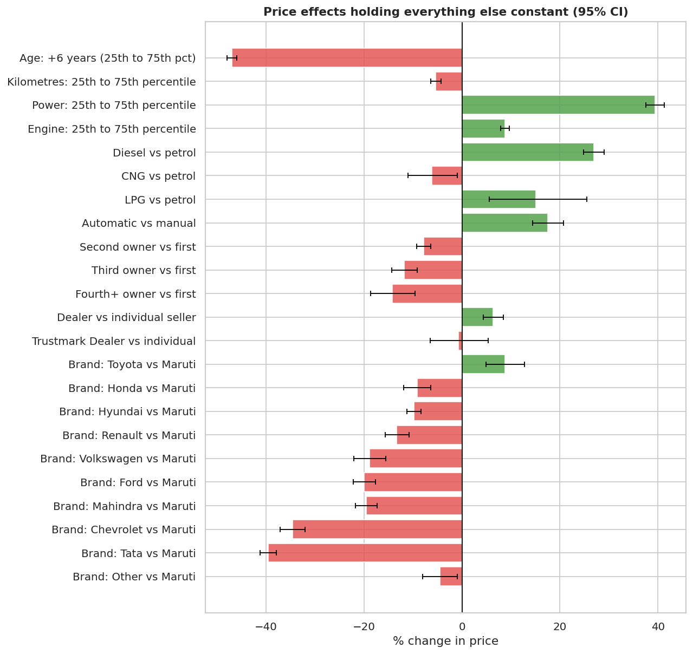</td>
<td width="45%" valign="top">

**Biggest effects**

- **Age:** a car 9 years old instead of 3 is about **47% cheaper**
- **Power:** moving from 67 to 100 bhp is worth about **+39%**
- **Brand vs Maruti:** Tata about **−40%**, Chevrolet **−35%**, Toyota **+9%**
- **Automatic vs manual:** about **+18%**
- **Owners vs first:** second **−8%**, third **−12%**, fourth-plus **−14%**
- **Kilometres:** minor, about **−5%** across the middle half of cars

</td>
</tr>
</table>

### Mileage depends on what you control for

<table>
<tr>
<td width="60%">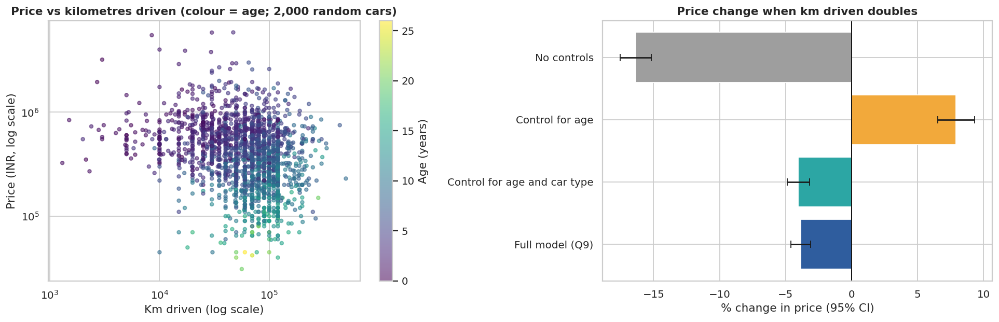</td>
<td width="40%" valign="top">

| Controls | Doubling km |
|---|---:|
| None | **−16.4%** |
| Age | **+7.9%** |
| Age and car type | **−4.0%** |
| Full model | **−3.9%** |

Among cars of the same age, the high-mileage ones are mostly diesels, which cost more. Only once car type is controlled does mileage show its modest true cost.

</td>
</tr>
</table>

---

## All 11 questions at a glance

| Q | Question | Answer |
|:-:|---|---|
| 1 | Shape of prices and ages? | Price is heavily right-skewed (median 400,000); log price is near-symmetric |
| 2 | How does price decay with age? | Median falls from 625,000 at age 3 to 105,000 at age 15 (about 14% a year) |
| 3 | Linear or exponential? | Exponential: R² 0.52 vs 0.19, about 12.6% lost per year |
| 4 | Which brands retain value best? | Volkswagen, Ford, Mahindra, Maruti; Chevrolet, Hyundai, Honda, Toyota lowest |
| 5 | Is there a diesel premium? | Yes: 72% raw, about 27% like-for-like |
| 6 | Cost of each extra owner? | Median 500,000 → 305,000 → 222,500 → 170,000 raw; −8%, −12%, −14% like-for-like |
| 7 | Does transmission matter? | Automatics cost 850,000 vs 385,000 raw, but about +18% like-for-like |
| 8 | How much does mileage reduce price? | Sign flips with controls; about −4% per doubling once car type is held fixed |
| 9 | What moves price most? | Age, power and brand; the model explains 88% of variation |
| 10 | Which listings are bargains? | Deal Score from out-of-sample predictions, median error 10.9% |
| 11 | How sure are brand averages? | Typical price from about 225,000 (Chevrolet) to 706,000 (Toyota); Hyundai/Ford and Mahindra/Honda overlap |

<details>
<summary><b>See the remaining charts</b></summary>

<br>

<table>
<tr>
<td>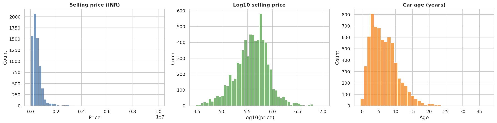</td>
<td>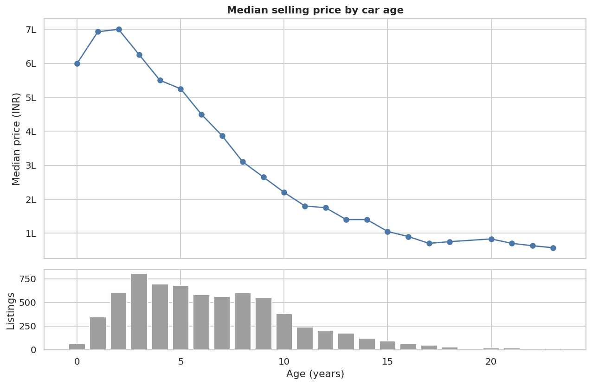</td>
</tr>
<tr>
<td>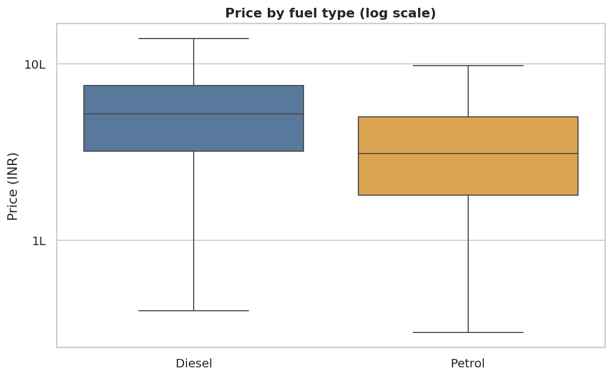</td>
<td>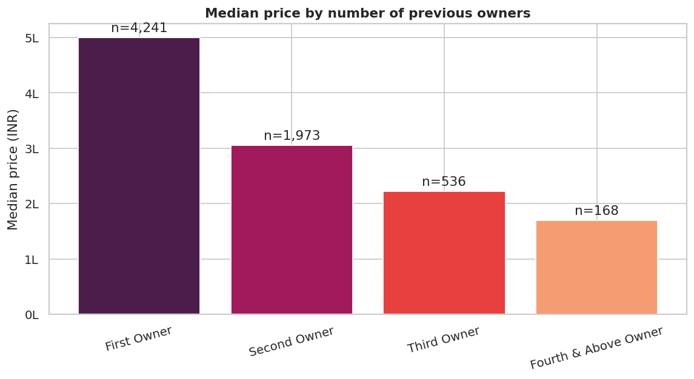</td>
</tr>
<tr>
<td>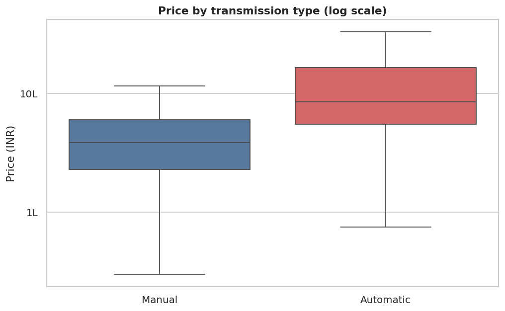</td>
<td>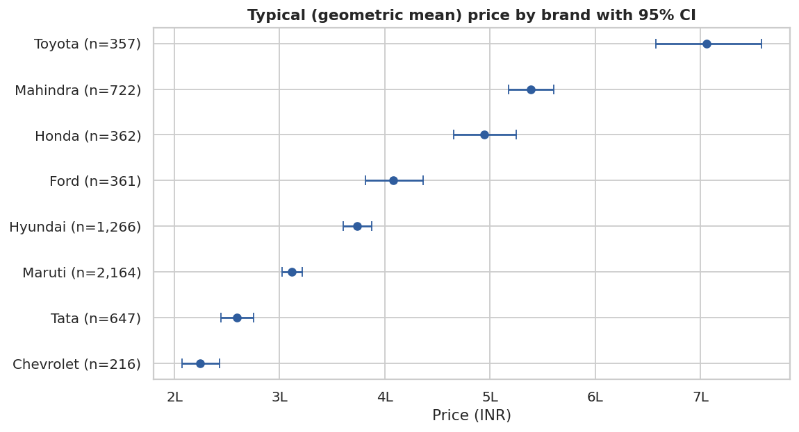</td>
</tr>
</table>

</details>

---

## Data cleaning

<details>
<summary><b>What was found and how it was handled</b></summary>

<br>

| Issue | What was found | How it was handled |
|---|---|---|
| Duplicates | 1,202 rows (14.8%), up to 34 copies; 88.6% of Trustmark Dealer rows and 61% of BMW rows | Removed before any analysis, so they cannot inflate averages or leak across cross-validation folds |
| Units in text | `mileage` mixes `kmpl` and `km/kg`; engine and power carry units | Numbers and units parsed separately; mileage not used in the models |
| Missing specs | 209 rows, older and cheaper (median age 12 vs 6) | Kept for price-vs-age questions; left out of spec-based models |
| Impossible kilometres | 1.5 and 2.36 million km (about 180,000 km a year) and a 2011 car at 1 km | Removed (3 rows) |
| Impossible values | 3 power readings of zero | Set to missing |
| Multi-word brands | `Land`, `Ashok` | Repaired to `Land Rover`, `Ashok Leyland` |
| Test-drive cars | 5 demo cars | Excluded from owner analyses |

</details>

## Limitations

- **Asking prices**, not final sale prices, and no location, condition or accident history.
- **Cross-sectional data:** different cars of different ages are compared, so "depreciation" is an association, not one car tracked over time.
- **Small groups:** luxury brands are too few to score, Renault's estimate rests on a short age range, and the CNG, LPG and Trustmark Dealer effects rest on 51, 35 and 27 cars.
- **Dated:** the file comes from early 2020, so price levels are not today's market.

## How to run

```bash
git clone <this-repo>
cd cardekho-depreciation-decoder
pip install -r requirements.txt
# Download Car_details_v3.csv from Kaggle into data/ (see Dataset), then:
jupyter lab cardekho_depreciation_decoder.ipynb
```


```
├── cardekho_depreciation_decoder.ipynb   # full analysis with saved outputs
├── images/                               # charts shown in this README
├── data/                                 # put Car_details_v3.csv here (not committed)
├── requirements.txt
└── README.md
```

## Dataset

- **Source:** [Vehicle dataset from CarDekho (Kaggle, Nehal Birla)](https://www.kaggle.com/datasets/nehalbirla/vehicle-dataset-from-cardekho)
- **File used:** `Car_details_v3.csv` (13 columns: name, year, selling_price, km_driven, fuel, seller_type, transmission, owner, mileage, engine, max_power, torque, seats)
- Check the dataset page for its licence and terms before redistributing the data. The raw CSV is excluded from this repository by `.gitignore`.
